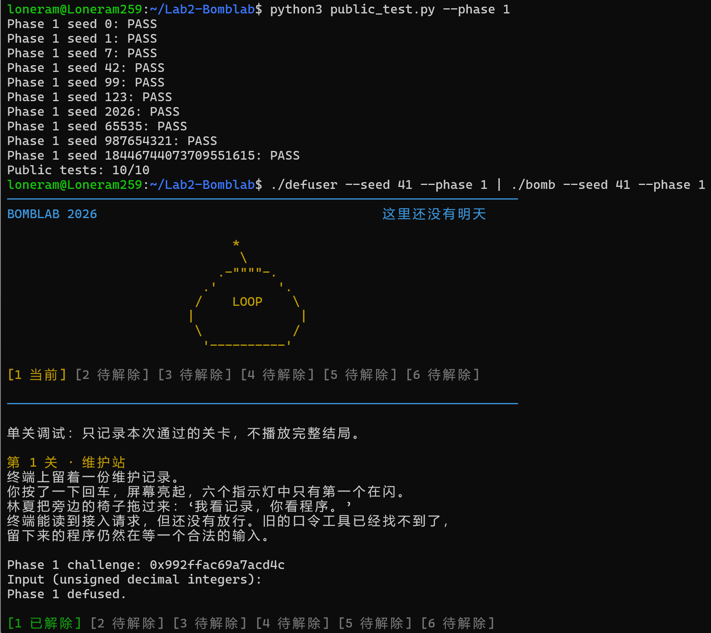
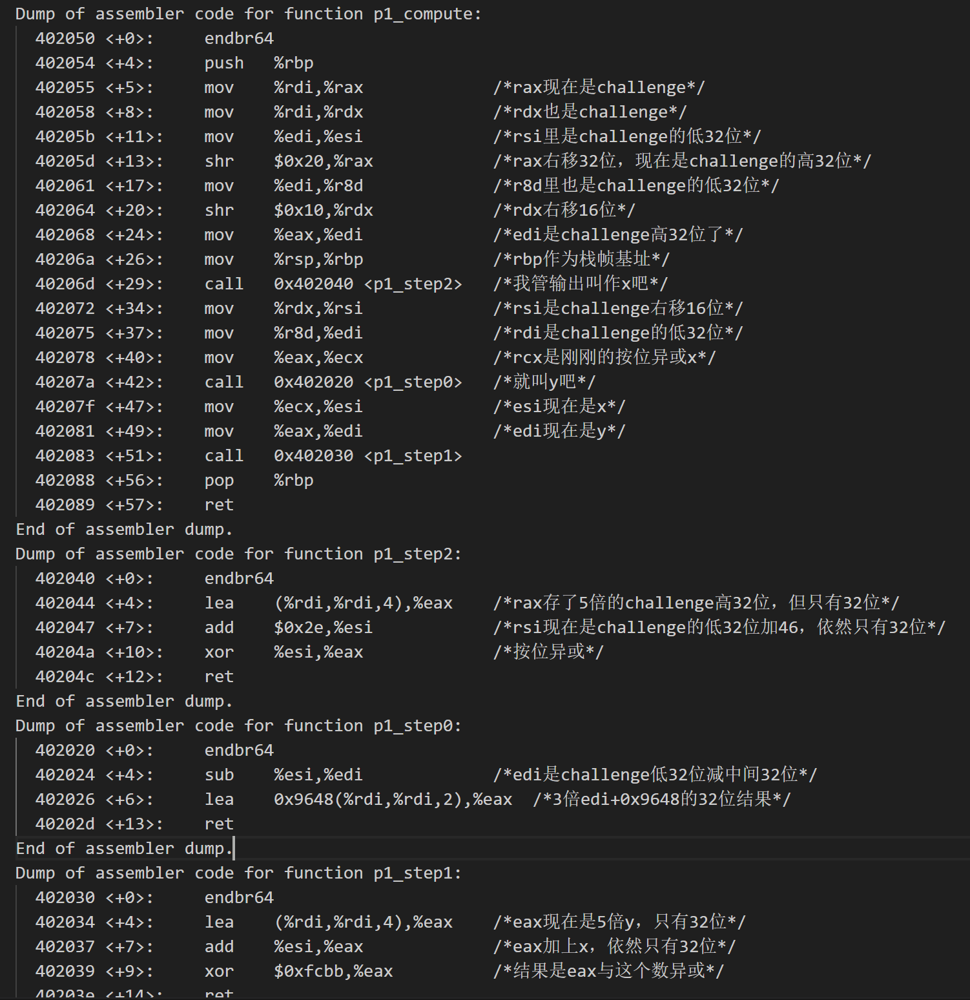
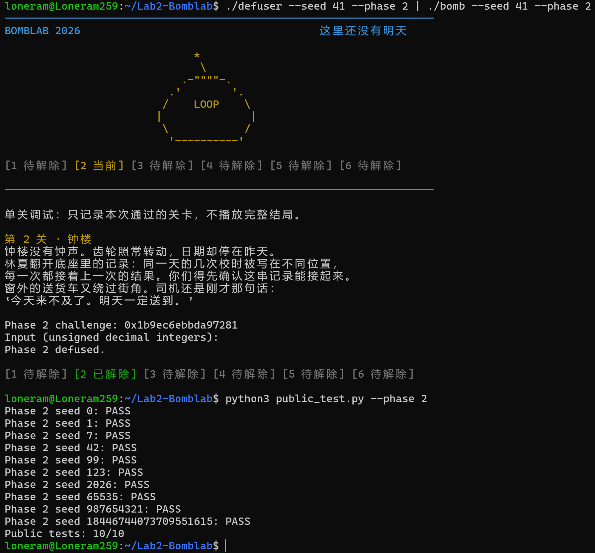
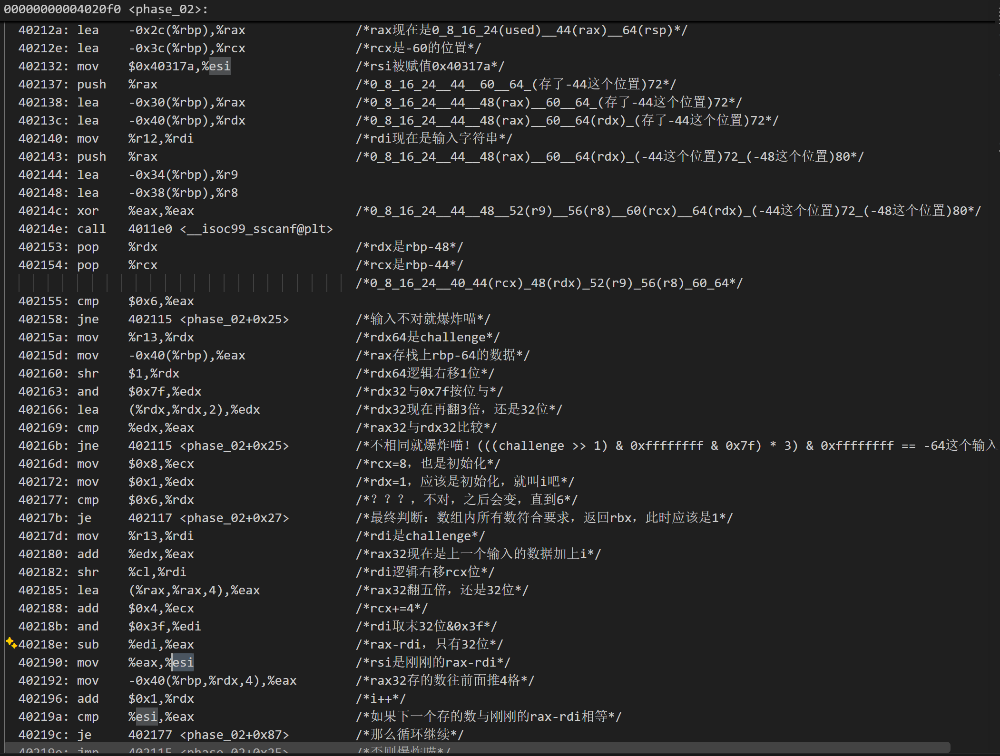
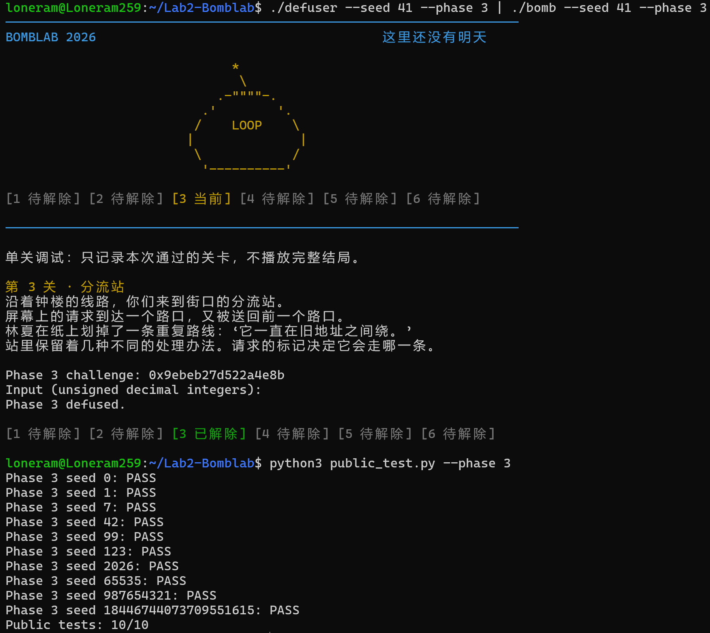
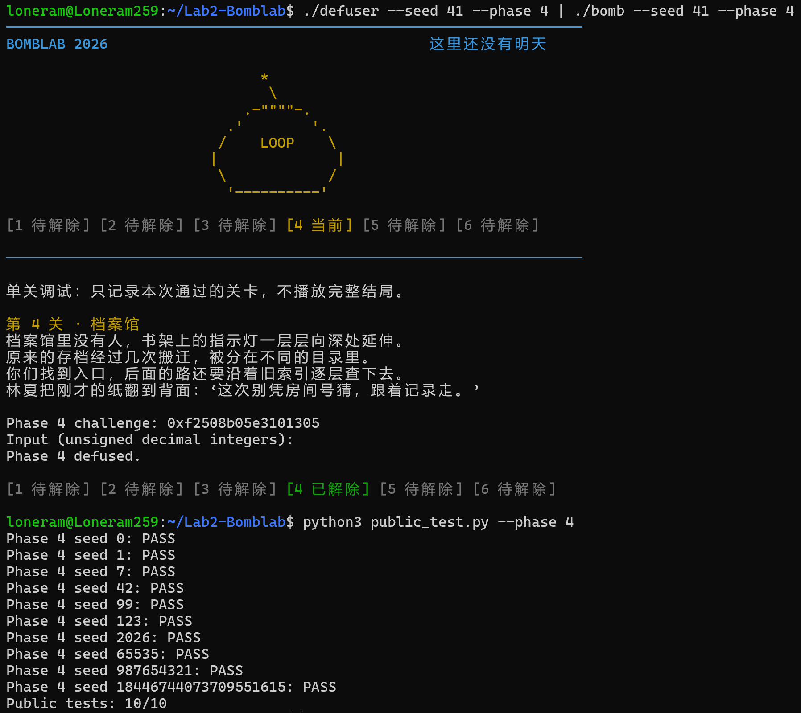
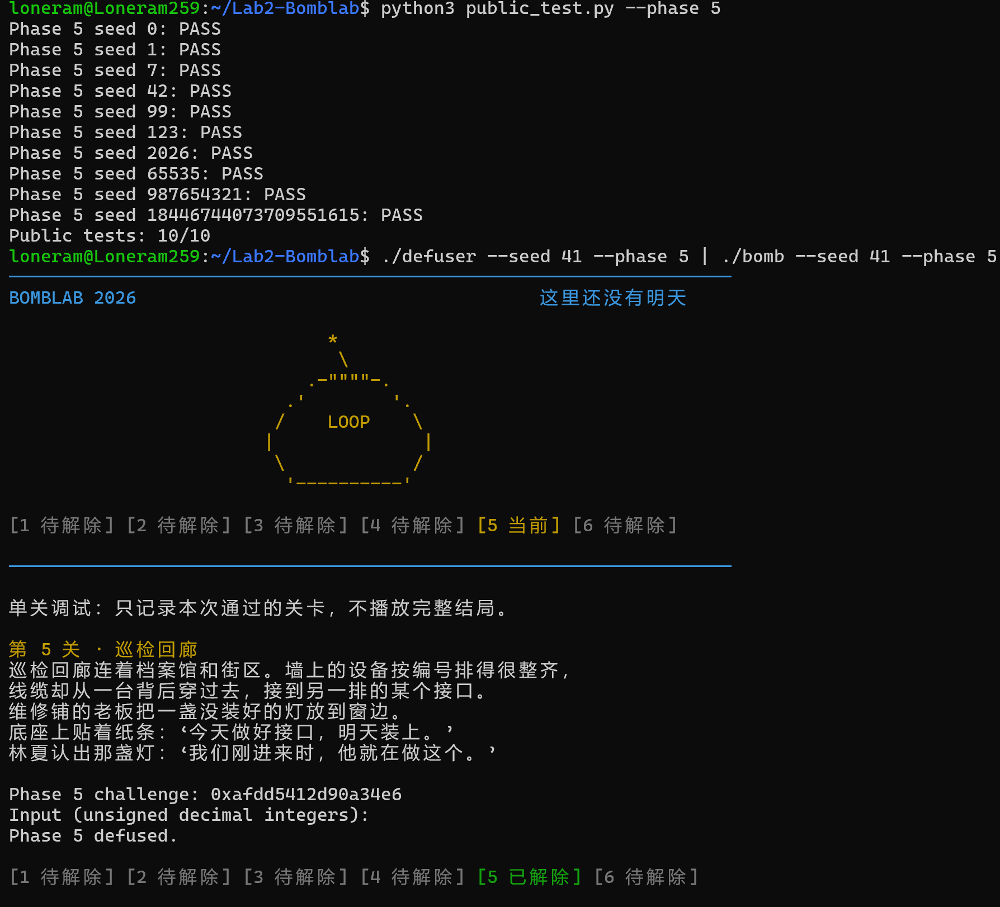
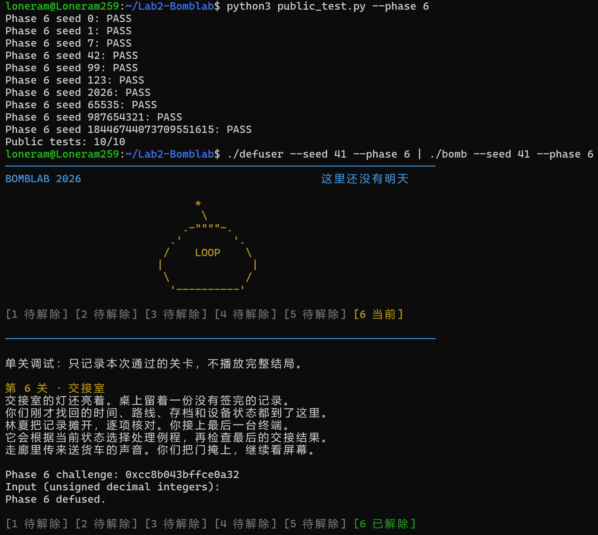
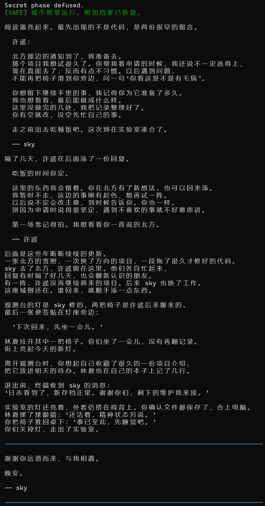
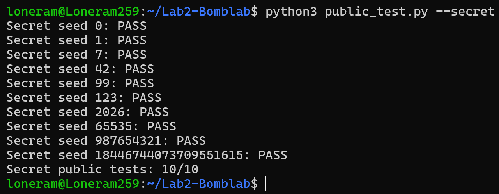

# Lab2实验报告

## Phase01

如图，第一题确实没什么难度和复杂性，当然我也没什么经验，反正就自行把所有汇编代码翻译了一遍，没做除此以外的任何草稿，毕竟只要看我自己翻译出的人话就足以做这题了。

## Phase02

循环比想象中隐蔽，如果顺序解读，很容易在同一个寄存器上，带入相同的值导致无法理解发生了什么，毕竟这里不像书上，只有代码的地址，没有给块的名字，更加难懂。当然，这一题复杂性还好，所以还是老办法，没有做翻译代码以外的任何草稿也能做。

## Phase03

间接调用卡了一下，除此之外也没有什么值得说的思路。但是打乱顺序好烦啊。

[查看第三关汇编](asm/phase_03.S)

## Phase04

不太会递归结构，所以感觉比别的题目难得多。非常诡异的题意，一开始根本看不出目的，所以磕磕绊绊。跟着递归了好多次，才看出eax在前半一直是处于二分法的递归当中，二分完了，才会参与后面的运算，然后给出答案。

写成c的思路就是先循环二分，并填入二分结果。然后倒序输出上一个数组的结果，循环switchcase进行计算。

[查看第四关汇编](asm/phase_04.S)

## Phase05

呃呃，好诡异的代码，怎么地址里面存的东西还是地址，然后连续操作的。
找到405b60和405ba0的内容后，结果相对好了一点，至少看懂在操作什么了，关键问题是怎么用c写出来。
依旧考虑数组加switch的方式，哦，还算善良，switch都不用了，index+1就可以了。

[查看第五关汇编](asm/phase_05.S)

## Phase06

程序设计课才进行到一半喵，函数什么的，指针什么的，全都不会喵，只能用switch语句凑合了喵。
呃呃，好复杂的汇编代码，终于开始理解为什么要用gdb去调试了，之前运气太好导致的。

额，从这题开始，我选择上传gdb给的汇编代码文件作为我的思路证明，代码旁边就是我的注释。哦对，这其实是我做的第3题，所以3，4，5也是这样的。当然，1、2的也上传到asm这个文件夹了。

[查看第六关汇编](asm/phase_06.S)

## Honor

不清楚之前几个汇编代码到底是怎么运行的，毕竟这里phase段也不是起点，有点晕，所以直接找了整个bomb的汇编代码，找出了莫名其妙出现的rdx的含义，真麻烦。
看样子像是字符串和字符数组相关的，还好之前没上头做完，这周程设课刚学才开始动手。
哇，还有一个小坑！第一步存的是esi，64位被压成了32位，然后esi再移位！所以不可以全部写成一条式子，太隐蔽了。主要还是之前的汇编代码没有这样的情况，全都是先rsi，最后esi的。
相关snprint语法没学过，请教了ai这个函数怎么用。

[查看隐藏关汇编](asm/honor.S)
## 引用资料与帮助
使用大语言模型帮我对网页上复杂的bomblab具体要求进行了简化，以便阅读

由于本学期还在上程序设计，对C语言了解并不充分，询问了大语言模型获得必要的语法知识

让大语言模型直接帮我整理了题目所涉各个指令的含义以及寄存器的名称及对应功能，避免反复翻书浪费时间